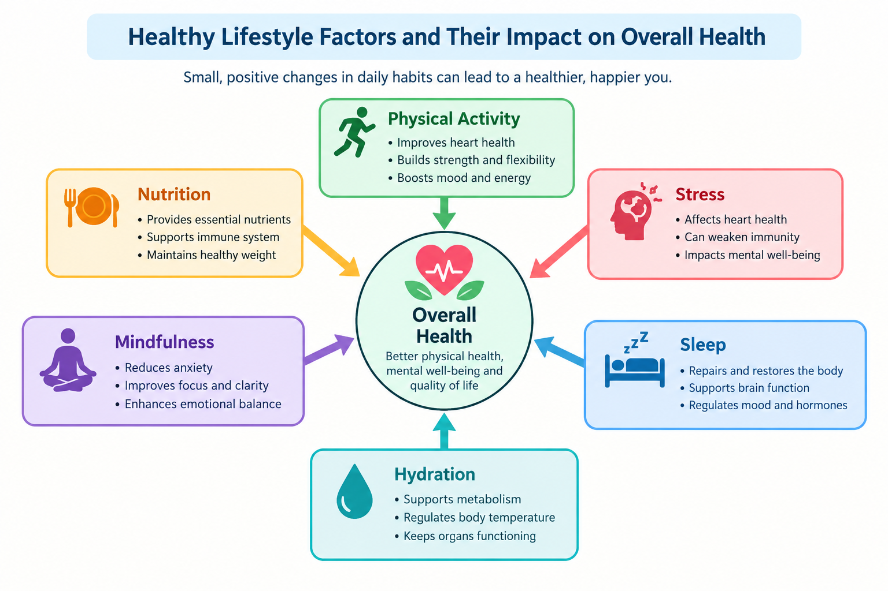

# <u>Measuring Holistic Lifestyles and Wellbeing</u>

> **To what extent are daily lifestyle habits—including physical activity, nutrition, sleep, mindfulness and smoking—associated with overall health scores, and how accurately can these factors predict health-status categories within a synthetic dataset?**

## Synthetic Data-Driven Insights for Human-Centred Research

*Measuring Holistic Lifestyles and Wellbeing* is a collaborative team
analysis addressing hypothetical research questions concerning holistic
lifestyle and wellbeing factors.

The project uses an end-to-end analytical approach, combining exploratory
data analysis, statistical methods and machine learning to investigate
relationships between lifestyle indicators and synthetic health scores.
It also examines the benefits, limitations and ethical implications of
interpreting health-related data.

## **<u>Stakeholder Summary</u>**

The analysis demonstrates how data analytics can identify patterns and evaluate predictive models while highlighting the limitations of reducing complex human wellbeing to a numerical score.

For stakeholders, *Measuring Holistic Lifestyles and Wellbeing*  illustrates the importance of transparent scoring methods, appropriate model evaluation and human oversight when interpreting health-related data. 

Although this project uses synthetic data to explore relationships between lifestyle factors and overall health scores, applying a similar approach to verified real-world data could help public health researchers identify health trends, healthcare providers understand behavioural risk factors, and wellbeing organisations develop targeted prevention programmes to address lifestyle-related health patterns.

---

### Planning and Coordination

[View the repository](https://github.com/LieneRubule/Holistic-Health-and-Lifestyle-Score-Dataset)

GitHub provided a shared location for the project files, task planning
and integration of contributions.

## Project Board

Project tasks, issue tracking, and team progress were managed through the GitHub Project Board
[View the Project Board](https://github.com/users/LieneRubule/projects/5/views/1)

- **Issues** divided the project into identifiable tasks.
- **The project board** organised priorities and made responsibilities
  visible to the team.
- **Must, Should, Could and Won’t priorities** helped distinguish
  essential work from optional additions.
- **Milestones** grouped related tasks around project deliverables.
- **Branches and pull requests** supported the integration of work
  produced by different team members.
- **Commits** recorded changes and provided a history of development.

## **<u>Dataset</u>**

- **Dataset:** Holistic Health & Lifestyle Score Dataset
- **Creator:** Arif Miah (Kaggle username: miadul)
- **Source:** [Kaggle dataset page](https://www.kaggle.com/datasets/miadul/holistic-health-and-lifestyle-score-dataset)
- **Download date:** [26/10/2026]
- **Licence:** [CC0 1.0 Universal — Public Domain](https://creativecommons.org/publicdomain/zero/1.0/)

The licence permits copying, modification and redistribution. The creator and source are acknowledged for transparency.

**Columns:**
- <code>Physical_Activity</code> - Minutes of moderate to vigorous exercise per day (0–120)

- <code>Nutrition_Score</code> - Diet quality (0–10) based on nutrient density, balance and variety

- <code>Stress_Level</code> - Self-reported stress (1–10), where 10 = very high stress

- <code>Mindfulness</code> - Minutes per day spent in meditation, journaling, or mindful activity (0–60)

- <code>Sleep_Hours</code> - Average hours of sleep per night (3–10)

- <code>Hydration</code> - Liters of water consumed per day (0.5–5.0)

- <code>BMI</code> - Body Mass Index (18–40)

- <code>Alcohol</code> - Units of alcohol per week (0–20)

- <code>Smoking</code> - Cigarettes per day (0–30)

**Limits:** The analysis describes patterns in the generated data and should not be interpreted as established relationships for real-world populations or used for individual health assessments.

---

## Methodology

### Data Collection

A synthetic health and lifestyle dataset was used for this project. Each record represents a simulated individual and includes lifestyle, behavioural and physical health indicators alongside an overall health score and health-status classification.

### Data Cleaning and Preparation

The dataset was inspected to assess its structure, data types, completeness and consistency. Missing values, duplicate records and numerical ranges were checked, and column names were standardised where necessary. The overall health score was validated against the supplied scoring methodology before the cleaned dataset was exported for further analysis.

### Exploratory Data Analysis

Exploratory Data Analysis (EDA) was conducted using Python libraries including pandas, NumPy, Matplotlib and Seaborn. Variable distributions, relationships between lifestyle factors and health outcomes, and differences between health-status groups were examined using summary statistics and visualisations.

### Statistical Analysis

Statistical analysis was performed to investigate relationships between lifestyle indicators and overall health scores. The analysis included descriptive statistics, correlation analysis, group comparisons and hypothesis testing to assess the strength and significance of observed patterns.

### Feature Preparation and Machine Learning

The validated dataset was prepared for predictive modelling by selecting relevant lifestyle variables and defining classification and regression targets. Potential target leakage was assessed, and feature selection was informed by the dataset's scoring methodology and the limitations of predicting formula-derived outcomes.

### Dashboard Development

An interactive Tableau dashboard was developed to present the research questions, visualisations, statistical findings and predictive modelling results. The dashboard also includes discussion of methodological considerations, limitations and ethical implications associated with the analysis.

## Analysis Techniques Used

| Technique | Application |
| --- | --- |
| Descriptive Statistics | Summarised the dataset through measures such as means, medians, standard deviations and percentiles. |
| Correlation Analysis | Examined relationships between lifestyle variables and overall health score using Pearson correlations. |
| Group Comparisons | Compared score distributions and average scores between smoking and non-smoking groups. |
| Hypothesis Testing | Used Welch's t-test to assess differences between smoking-group means. |
| Multiple-Testing Adjustment | Applied Holm correction across the primary statistical tests. |
| Sensitivity Analysis | Used Spearman correlations and Mann-Whitney U tests to assess the robustness of findings. |
| Classification Modelling | Predicted Poor, Average and Good health-status categories using machine learning models. |
| Regression Modelling | Predicted numerical overall health scores using regression techniques. |
| Model Interpretation | Examined feature importance to understand model behaviour and the influence of lifestyle factors. |

Statistical findings were interpreted alongside confidence intervals, effect sizes and the synthetic nature of the dataset. Statistical significance was not considered evidence of causation or practical importance in isolation.

## Data Cleaning and Validation

Liene inspected and validated the dataset before sharing it with
the team for analysis.

| Check | Result |
|---|---|
| Dataset structure | 10,000 records and 11 columns. |
| Missing values and duplicates | None found. |
| Numerical ranges | All values within the checked ranges. |
| Health-status categories | All matched the expected score boundaries. |
| Health-score calculation | All 10,000 scores matched the predefined formula within numerical tolerance. |
| Export and reload | Confirmed the exported data remained consistent. |

No rows were removed or missing values filled. A data dictionary
was created to document all 11 variables.

**Outputs:**
- [Data dictionary](outputs/data_dictionary/health_data_dictionary.csv)
- [Validated dataset](cleaned_datasets/holistic_health_lifestyle_cleaned.csv)

The validated dataset provided a shared foundation for EDA,
hypothesis testing, machine learning and the dashboard.

## Exploratory Data Analysis (EDA)

The EDA examined the structure of the dataset, the distribution of variables, and the relationships between lifestyle factors, Overall Health Score, and Health Status. This analysis provided the foundation for the statistical testing and predictive modelling stages.

### Dataset Overview

- 10,000 synthetic health records
- 11 variables, including lifestyle indicators, Overall Health Score, and Health Status
- No missing values identified
- Analysis completed using Python, pandas, Matplotlib, Seaborn, and Jupyter Notebook
- Overall Health Score is derived from a predefined scoring formula

### EDA Activities

The analysis included:

- Inspecting dataset dimensions, data types, and missing values
- Generating descriptive statistics for numerical variables
- Exploring correlations between variables
- Examining score distributions and Health Status categories
- Comparing lifestyle factors across health groups
- Creating visualisations to support interpretation of findings

### Key Findings

- The dataset is heavily weighted towards the **Good** Health Status category, creating class imbalance that should be considered when evaluating classification models.
- **Mindfulness** showed the strongest positive relationship with Overall Health Score.
- **Nutrition Score** demonstrated a moderate positive relationship with Overall Health Score.
- **Smoking** showed a negative relationship with Overall Health Score.
- Individuals in the **Good** Health Status group generally reported:
  - Higher physical activity levels
  - More mindfulness activity
  - Longer sleep duration
  - Lower smoking rate

### Limitations

The Overall Health Score is calculated using the lifestyle variables contained within the dataset. As a result, observed relationships partly reflect the design of the scoring system rather than independent real-world associations. Findings should therefore be interpreted within the context of this synthetic dataset and not generalised to real populations.

---

## Research Questions and Hypothesis Validation

Four research questions were investigated using statistical analysis and machine learning. All conclusions apply only to this synthetic dataset.

### H1: Physical Activity and Overall Health Score

**Question:** Is higher physical activity associated with a higher Overall Health Score?

**Result:** Supported. Physical activity showed a statistically significant positive relationship with Overall Health Score, although the association was relatively weak.

### H2: Nutrition and Overall Health Score

**Question:** Is a higher Nutrition Score associated with a higher Overall Health Score?

**Result:** Supported. Nutrition Score showed a moderate positive relationship with Overall Health Score and a stronger association than physical activity.

### H3: Smoking and Overall Health Score

**Question:** Do health scores differ between smoking and non-smoking groups?

**Result:** Supported. Non-smokers had significantly higher Overall Health Scores than smokers within this dataset.

**Visualisation:**  
[Smoking vs Health Score](visuals/q3_smoking_vs_health_boxplot.png)

### H4: Predicting Health Status

**Question:** Can lifestyle factors accurately predict Health Status?

**Result:** Supported. Logistic Regression achieved 99.55% accuracy and a macro F1 score of 0.9886, substantially outperforming the majority-class baseline.

**Visualisation:**  
[Classification Confusion Matrix](visuals/classification_confusion_matrix.png)

### Key Predictors

Feature importance analysis identified **Mindfulness**, **Nutrition Score**, and **Smoking** as the most influential variables in predicting health outcomes.

**Visualisation:**  
[Correlation Heatmap](visuals/02_correlation_heatmap.png)

### Summary

All statistical tests remained significant after Holm adjustment, and sensitivity analyses produced consistent results. Because the Overall Health Score is derived from the input variables, findings should be interpreted within the context of this synthetic dataset and not generalised to real-world populations.

**Additional Results:**  
[Hypothesis Test Results](cleaned_datasets/hypothesis_test_results.csv)

---

## Machine Learning

Two machine learning tasks were explored:

- **Classification** – Predicting Health Status (Poor, Average, Good).
- **Regression** – Predicting Overall Health Score.

Nine lifestyle variables were used as input features, while `Overall_Health_Score` and `Health_Status` were excluded to reduce target leakage.

### Classification

Logistic Regression achieved the strongest classification performance, with **99.55% accuracy** and a **0.9886 Macro F1 Score**, substantially outperforming the majority-class baseline.

**Visualisation:**  
- visuals/classification_confusion_matrix.png

### Regression

Random Forest achieved the best regression performance, with an **R² of 0.9229**, **RMSE of 5.47**, and **MAE of 3.96**.

### Key Findings

Feature importance analysis identified **Mindfulness**, **Nutrition Score**, and **Smoking** as the most influential predictors across both classification and regression models.

As the health outcomes are derived from the same lifestyle variables used as inputs, these results demonstrate how well the models reproduce the dataset's constructed relationships and should not be interpreted as evidence of real-world health prediction.

### Additional Results

- outputs/classification_model_comparison.csv
- outputs/regression_model_comparison.csv
- outputs/regression_model_metrics.csv
- outputs/classification_feature_importance.csv
- outputs/regression_feature_importance.csv

---

# <u>**Dashboard Creation**</u>

**Live Dashboard Link:** https://public.tableau.com/views/HolisticHealthLifestyleAnalysis/00-Coverpage

The Tableau dashboard was designed to communicate the findings of the exploratory data analysis and machine-learning investigation using a synthetic health and lifestyle dataset. A dedicated cover page introduces the project's research questions, analytical purpose and ethical considerations. Across the dashboards, explanatory text contextualises observed relationships, highlights differences between smoking groups, and communicates the limitations of predictive modelling.

The dashboard explores associations between physical activity, nutrition and overall health scores; examines distributions and trends across lifestyle score ranges; compares average health scores and health-status distributions between smokers and non-smokers; and evaluates the performance of classification models in predicting Poor, Average and Good health-status categories. Feature importance visualisations identify which variables contribute most to the model's predictions.

Together, these visualisations investigate how lifestyle variables relate to the dataset's formula-derived health scores and how effectively those patterns can be classified. Ethical disclosures emphasise that statistical associations do not establish causation, feature importance does not demonstrate causal influence, and model performance within synthetic data cannot be assumed to generalise to real-world populations. The dashboard is intended for educational and portfolio purposes, not medical advice or clinical decision-making.

## Dashboard Features

| Feature | What users can explore | Why it is useful |
| --- | --- | --- |
| Lifestyle associations | Scatter plots and trend lines for activity, nutrition and health score | Shows the direction and variation of observed relationships |
| Trends and distributions | Line charts and histograms across activity and nutrition ranges | Places averages alongside the distribution of records |
| Smoking-group comparison | Average-score KPIs, a box plot and a health-status comparison table | Compares group averages, spread and category representation |
| Model evaluation | Model-accuracy comparisons and feature importance | Communicates predictive performance and model-specific input rankings |
| KPI cards | Key numerical summaries for selected groups | Makes headline values easy to locate |
| Interactive exploration | Tooltips and dashboard interactions | Supports closer examination of categories and score ranges |
| Ethical disclosure | Explanations of synthetic data, bias and predictive reliability | Helps prevent causal or clinical overinterpretation |
| Visual design | Turquoise, orange and charcoal palette, annotations and consistent layouts | Supports readable navigation and comparison |

**Dashboard Pages**

**Cover Page — Measuring Holistic Health and Wellbeing**
Introduces the project's research questions, analytical purpose and ethical disclaimer, highlighting the use of synthetic data and the limitations of interpreting health-related patterns.

**Page 1 — Let's Get Physical & Food for Thought**
Explore the relationships between physical activity, nutrition and overall health scores using scatter plots and trend lines. Examine how these lifestyle variables are associated with the dataset's formula-derived health scores, without assuming causal relationships.

**Page 2 — Trending Towards Wellbeing**
Examine average health scores and record distributions across physical activity and nutrition score ranges. KPI cards highlight average scores, while line charts and histograms reveal patterns within the synthetic dataset.

**Page 3 — The Burning Question: Smoking and Health**
Compare average health scores between smokers and non-smokers using KPI cards, a box plot and a health-status comparison table. Explore differences in score distributions and the representation of Poor, Average and Good health-status categories.

**Page 4 — A Healthy Guess?**
Evaluate classification model performance in predicting Poor, Average and Good health-status categories. Compare model accuracy and examine feature importance to identify which lifestyle variables contribute most to predictions, while acknowledging the limitations of synthetic data and the risks of overinterpreting model results.

## Project Management and Development Roadmap

### Our Team Commitment

We approached this project as five contributors working towards one
shared outcome: a clear, reliable and responsibly interpreted analysis
of lifestyle patterns within a synthetic health dataset.

We agreed our responsibilities together, giving each member ownership
of a defined part of the project while recognising that every stage
depended on the work of others. Data preparation supported exploration;
exploration informed further investigation; statistical testing and
machine learning provided findings for the dashboard and documentation.

Our commitment was to contribute actively, communicate clearly, support
one another and take shared responsibility for the quality of the final
project. Individual ownership gave us direction, while collaboration
helped bring the separate contributions into one coherent analysis.

### Shared Project Goals

| Goal | What this meant for our work |
| --- | --- |
| Establish reliable inputs | Inspect, document and validate the dataset before using it for analysis |
| Answer clear research questions | Connect exploratory findings, statistical tests and predictive modelling to the project aim |
| Make results understandable | Use appropriate charts, explanations and an interactive dashboard |
| Interpret findings responsibly | Distinguish patterns in synthetic data from evidence about real-world health |
| Maintain traceable work | Use GitHub issues, branches, commits and pull requests to organise contributions |
| Deliver a consistent project | Align notebooks, exported results, visualisations, documentation and presentation materials |

### Team Involvement and Responsibilities

The following responsibilities reflect our agreed allocation, with the
final README handover noted below.

| Team member | Primary responsibility | Contribution and deliverables |
| --- | --- | --- |
| **Liene** | Data preparation, cleaning and GitHub management | Investigated the dataset, created the data dictionary, checked the scoring formula, validated data quality, exported the cleaned dataset and managed repository organisation and integration. Took over final README completion following the documentation handover. |
| **Kavitha** | Exploratory Data Analysis | Examined distributions, descriptive statistics and relationships between variables; produced EDA visualisations and findings to support subsequent analysis. |
| **Nadjat** | Hypothesis testing | Developed and investigated statistical hypotheses, selected appropriate tests, carried out sensitivity checks and documented the interpretation of results. |
| **Hema** | Machine learning | Prepared model inputs, compared classification and regression models, evaluated predictive performance and documented model interpretation and limitations. |
| **Viktoria** | Dashboard development and initial documentation coordination | Developed the Tableau dashboard, brought together findings and visualisations, and coordinated the initial README contribution before handing final completion to Liene. |
| **Entire team** | Shared direction, review and communication | Contributed to the project aim, dataset selection, responsibilities, ethical considerations, review and preparation for the final presentation. |

**Documentation handover:** Viktoria initially coordinated the README.
Liene subsequently took responsibility for completing and organising
the final document, drawing on the team's analytical contributions.

### Agreed Peer Review Plan

The team agreement established a review cycle so that each person's
work had a named reviewer. This allocation describes the review plan,
rather than claiming that every review has been completed.

| Work produced by | Assigned reviewer |
| --- | --- |
| Liene | Kavitha |
| Kavitha | Nadjat |
| Nadjat | Hema |
| Hema | Viktoria |
| Viktoria | Liene |

The review priorities were to check clarity, consistency and the
connection between methods, outputs and conclusions. Shared review
also provided an opportunity to identify missing explanations or
integration problems before final delivery.

### Development Roadmap

The roadmap shows how the work was organised and how the deliverables
connect. Some activities could progress in parallel once the cleaned
dataset was available; documentation and review supported multiple stages.

| Stage | Focus | Lead responsibility | Deliverable and handover |
| --- | --- | --- | --- |
| **1. Agree the direction** | Define the project aim, choose the dataset and agree responsibilities | Entire team | Shared research direction, issue allocation and team agreement |
| **2. Inspect and prepare** | Investigate variables, document definitions, check the score calculation and validate data quality | Liene | Data dictionary, cleaning notebook and validated dataset for downstream analysis |
| **3. Explore the data** | Examine distributions, correlations and differences between health-status groups | Kavitha | EDA notebook, seven visualisations and findings to inform investigation |
| **4. Test the hypotheses** | Assess activity and nutrition associations and compare smoking groups | Nadjat | Statistical results, sensitivity checks and evidence-based conclusions |
| **5. Evaluate predictive models** | Compare baseline, classification and regression models | Hema | Model comparisons, evaluation metrics, feature importances and exported results |
| **6. Communicate findings** | Build the Tableau dashboard and organise the README | Viktoria; Liene for final README completion | Accessible visual explanations and documentation linked to the analysis |
| **7. Review and present** | Check consistency, review the repository and prepare the presentation | Entire team | A coordinated final explanation of the methods, findings and limitations |

### Team AI Use Statement

As a team, we used AI tools including ChatGPT, Claude, Gemini, and Microsoft Copilot to support various stages of the project. AI was used to help understand the dataset, plan the analysis, troubleshoot coding and GitHub issues, explain statistical methods, debug errors, improve documentation, assist with dashboard and presentation planning, and suggest suitable data visualisations and approaches.

AI support was used as a learning, guidance, and productivity tool rather than as a source of project findings. All code, analyses, visualisations, statistical outputs, interpretations, and documentation were reviewed by team members and checked against the dataset, notebook outputs, and project requirements before being included in the final submission. Final decisions, validation, and responsibility for the project remained with the team.

---

## Technologies, Tools and Credits

The project was completed using the following technologies, platforms, libraries, and AI-assisted tools:

### Development and Collaboration

- Python
- Jupyter Notebook
- VS Code
- Git
- GitHub
- Markdown

### Data Analysis and Statistics

- pandas
- NumPy
- SciPy
- scikit-learn

### Data Visualisation

- Matplotlib
- Seaborn
- Tableau

### Documentation and Presentation

- Markdown
- Google Slides
- Microsoft PowerPoint

### AI-Assisted Tools

- ChatGPT
- Claude
- Gemini
- Microsoft Copilot

### Purpose of the Tools

These technologies were used for dataset inspection, cleaning, validation, exploratory data analysis, statistical testing, machine learning, dashboard development, project documentation, version control, team collaboration, and presentation preparation. AI tools were used to support learning, problem-solving, troubleshooting, planning, code explanation, documentation improvement, and communication of project findings.

---

## **<u>Ethical Considerations</u>** 

The analysis demonstrates how statistical methods can identify relationships and differences within structured data, but it also highlights the limitations of interpreting numerical health scores without understanding how they were constructed.

The overall health score is calculated from lifestyle factors and capped at 100. Consequently, the observed correlations may partly reflect the mathematical relationships embedded in the scoring formula rather than independent relationships between lifestyle and health. Similarly, statistically significant differences between smoking groups should not be interpreted as evidence of causation or as a clinical assessment of individual health.

The dataset's synthetic nature is central to interpreting the findings. Although the results support all three hypotheses within this dataset, they do not establish clinical validity or demonstrate that the same patterns would occur in real populations.

Ultimately, the project highlights the distinction between identifying statistical patterns and establishing meaningful evidence about human wellbeing. Numerical scores can make complex information easier to analyse, but their interpretation depends on the assumptions, definitions and calculations underlying them. The findings are therefore intended for educational and exploratory purposes, not clinical assessment or healthcare decision-making.

## **<u>Acknowledgements</u>**

We would like to thank the entire Code Institute team for their
guidance, encouragement and support throughout these four months,
and our fellow students for sharing the learning journey with us.

A special thank you to our team—Liene, Kavitha, Nadjat, Hema and
Viktoria—for the hard work, patience and support we gave one
another. Everyone brought something valuable to this project,
and we are proud of what we have achieved together.

