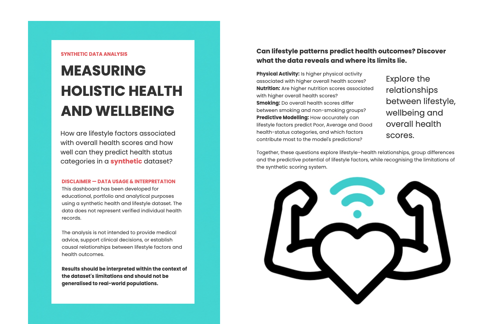
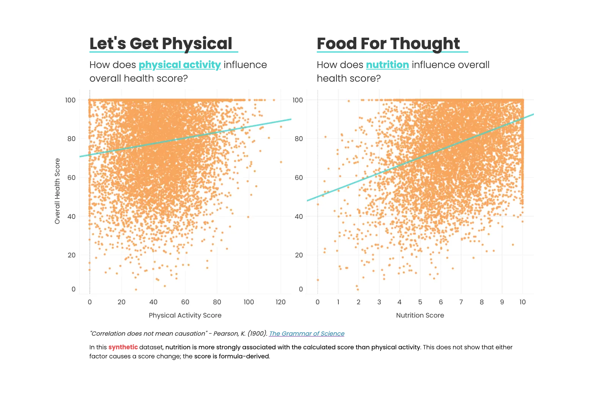
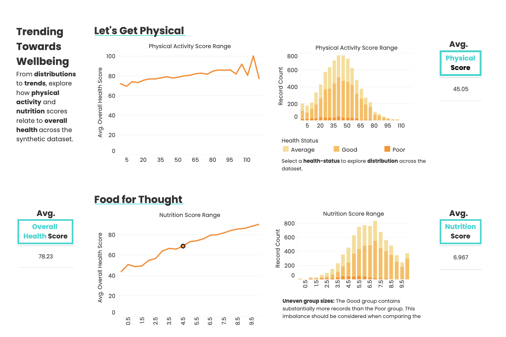
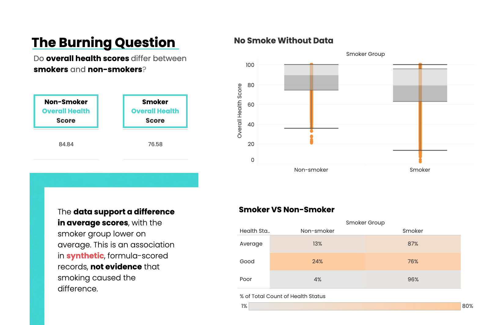
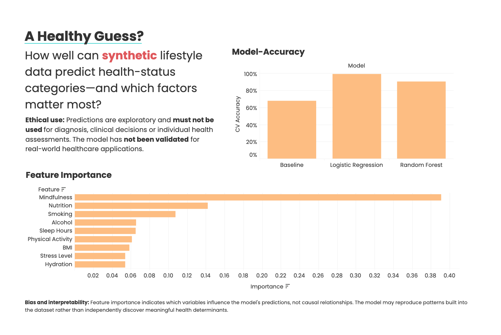

# <u>Measuring Holistic Lifestyles and Wellbeing</u>
## Synthetic Data-Driven Insights for Human-Centred Research 

*Measuring Holistic Lifestyles and Wellbeing* is a collaborative team analysis to address hypothetical research questions concerning holistic lifestyle and wellbeing factors. 

The project uses an end-to-end analytical approach by combining exploratory data analysis, statistical methods and machine learning to investigate relationships between lifestyle indicators and synthetic health scores, while examining the potential benefits, limitations and ethical implications of using data-driven insights to inform healthcare decisions.

## **<u>Stakeholder Summary</u>**

The analysis demonstrates how data analytics can identify patterns and evaluate predictive models while highlighting the limitations of reducing complex human wellbeing to a numerical score.

For stakeholders, *Measuring Holistic Lifestyles and Wellbeing*  illustrates the importance of transparent scoring methods, appropriate model evaluation and human oversight when interpreting health-related data. 

Although this project uses synthetic data to explore relationships between lifestyle factors and overall health scores, applying a similar approach to verified real-world data could help public health researchers identify health trends, healthcare providers understand behavioural risk factors, and wellbeing organisations develop targeted prevention programmes to address lifestyle-related health patterns.

## **<u>Dataset</u>**

- **Dataset:** Holistic Health & Lifestyle Score Dataset
- **Creator:** Arif Miah (Kaggle username: miadul)
- **Source:** [Kaggle dataset page](https://www.kaggle.com/datasets/miadul/holistic-health-and-lifestyle-score-dataset)
- **Download date:** [26/10/2026]
- **Licence:** [CC0 1.0 Universal — Public Domain](https://creativecommons.org/publicdomain/zero/1.0/)

The licence permits copying, modification and redistribution. The creator and source are acknowledged for transparency.

**Columns:**
- <code>Physical_Activity</code> - Minutes of moderate to vigorous exercise per day (0–120)

- <code>Nutrition_Score</code> - Diet quality (0–10) based on nutrient density, balance and variety

- <code>Stress_Level</code> - Self-reported stress (1–10), where 10 = very high stress

- <code>Mindfulness</code> - Minutes per day spent in meditation, journaling, or mindful activity (0–60)

- <code>Sleep_Hours</code> - Average hours of sleep per night (3–10)

- <code>Hydration</code> - Liters of water consumed per day (0.5–5.0)

- <code>BMI</code> - Body Mass Index (18–40)

- <code>Alcohol</code> - Units of alcohol per week (0–20)

- <code>Smoking</code> - Cigarettes per day (0–30)

**Limits:** Dataset is synthetic. Its variable definitions, measurement scales and score metric method require verification. The analysis descibes patterns in the generated data and should not be interpreted as established relationships for real-world populations or used for individual health assessments. 

## **<u>Project Plan</u>**

**Data Collection** – A synthetic health and lifestyle dataset is loaded for analysis. Each record represents a simulated individual, with physical and lifestyle indicators alongside an Overall Health Score and categorical Health Status.

**Data Cleaning and Preperation** – Data integrity is assessed before analysis by inspecting the dataset's structure, standardising column names where necessary, checking data types, and validating missing values, duplicate records and numerical ranges. The overall health scores are checked against the supplied scoring formula. The validated dataset is exported for subsequent analysis.

**Exploratory Data Analysis (EDA)** – Relationships between lifestyle indicators and overall health scores are explored using Pandas, NumPy, Matplotlib and Seaborn. 

**Statistical Analysis** – Descriptive statistics and appropriate statistical tests are used to investigate differences and associations between lifestyle indicators and overall health scores.

**Feature Engineering** – The validated dataset is prepared for machine learning by selecting relevant lifestyle variables and defining the target variable. The relationship between the input variables, Overall Health Score and Health Status is examined to identify potential target leakage. Features are selected with consideration of the scoring methodology and the limitations of predicting a formula-derived outcome.

## **Hypothesis Research Questions**

The following research questions combine correlation analysis, statistical hypothesis testing, and predictive modelling to investigate relationships between lifestyle factors and overall health scores, assess differences between smoking groups, and evaluate the predictive performance of machine learning.

1. Is higher physical activity associated with a higher overall health score? The hypothesis is that higher physical activity is positively associated with overall health scores. This is investigated through correlation analysis to examine the direction and strength of the relationship between physical activity and overall health scores.

2. Is a higher nutrition score associated with a higher overall health score? The hypothesis is that higher nutrition scores are positively associated with overall health scores. Correlation analysis is used to investigate whether improvements in nutrition scores correspond to higher overall health scores within the dataset.

3. Do overall health scores differ between smoking and non-smoking groups? The hypothesis is that mean overall health scores differ between records with smoking values greater than zero and those with smoking values equal to zero. A two-sample statistical test, using Welch's t-test where appropriate, is applied to assess whether the observed difference in group means is statistically significant.

4. How accurately can lifestyle factors predict health-status categories, and which factors contribute most to the model's predictions? The hypothesis is that a machine-learning classifier using lifestyle factors can predict the Poor, Average, and Good health-status categories more accurately than a baseline model that always predicts the most common category. Model performance is evaluated using classification metrics and a confusion matrix, while feature importance analysis explores which lifestyle factors contribute most to the model's predictions.

**Ethical and methodological considerations:** The dataset is synthetic and represents a constructed scoring system rather than independently measured real-world health outcomes. Consequently, the findings describe patterns within the dataset and should not be interpreted as evidence of real-world causal relationships or as a validated method for assessing individual health. Overall health scores are excluded from the model's predictor variables because the health-status categories are derived from these scores. This helps avoid target leakage and ensures that the model evaluates the predictive contribution of lifestyle factors rather than directly using the information from which the target categories were created.

### 🤖 Machine Learning Model Performance & Summary
* **Classification Pipeline (`Health_Status`):** Evaluated a baseline against Logistic Regression and Random Forest models using stratified 5-fold cross-validation. **Logistic Regression** emerged as the best-performing classifier, achieving a test accuracy of $96.55\%$ and a Macro F1-score of $0.9043$.
* **Regression Pipeline (`Overall_Health_Score`):** Evaluated models predicting the numerical health score. Both **Linear Regression** and **Random Forest Regressor** demonstrated strong predictive performance (Test $R^2 \approx 0.94$, RMSE $\approx 5.44$), with **Mindfulness**, **Smoking**, and **Nutrition_Score** identified as the primary feature drivers.
* **Dashboard Portability & Governance:** In accordance with team governance standards, binary model binaries (`.joblib`) were replaced by clean, portable CSV exports containing feature importances, scaler parameters, and evaluation metrics for dashboard integration.
* **Limitations & Ethics:** Because the dataset is synthetic, models learn the underlying scoring formula rather than real biological phenomena. Findings must be interpreted strictly as exploratory dashboard insights and do not constitute clinical or medical advice.


## <u>**Dashboard Creation**</u>

The Tableau dashboard was designed to communicate the findings of the exploratory data analysis and machine-learning investigation using a synthetic health and lifestyle dataset. A dedicated cover page introduces the project's research questions, analytical purpose and ethical considerations. Across the dashboards, explanatory text contextualises observed relationships, highlights differences between smoking groups, and communicates the limitations of predictive modelling.

The dashboard explores associations between physical activity, nutrition and overall health scores; examines distributions and trends across lifestyle score ranges; compares average health scores and health-status distributions between smokers and non-smokers; and evaluates the performance of classification models in predicting Poor, Average and Good health-status categories. Feature importance visualisations identify which variables contribute most to the model's predictions.

Together, these visualisations investigate how lifestyle variables relate to the dataset's formula-derived health scores and how effectively those patterns can be classified. Ethical disclosures emphasise that statistical associations do not establish causation, feature importance does not demonstrate causal influence, and model performance within synthetic data cannot be assumed to generalise to real-world populations. The dashboard is intended for educational and portfolio purposes, not medical advice or clinical decision-making.

#### **Dashboard Features**

- **Lifestyle association analysis:** Scatter plots and trend lines explore relationships between physical activity, nutrition and overall health scores.

- **Trends and distributions:** Line charts and histograms examine average health scores and record distributions across physical activity and nutrition score ranges.

- **Smoking-group comparison:** KPI cards compare average health scores for smokers and non-smokers, supported by a box plot and a health-status comparison table.

- **Classification model evaluation:** Bar charts compare model accuracy, while feature importance visualises the relative contribution of lifestyle variables to predictions.

- **KPI cards:** Highlight key numerical summaries, including average health scores for selected groups.

- **Interactive exploration:** Tooltips and dashboard interactions support closer examination of score ranges, health-status categories and observed patterns.

- **Ethical disclosure:** Dedicated explanatory text addresses synthetic data limitations, predictive reliability, potential bias, interpretation and responsible use.

- **User-centred design:** A consistent turquoise, orange and charcoal palette, clear typography, concise annotations and structured layouts support readability and visual comparison.

**Live Dashboard Link:** https://public.tableau.com/views/HolisticHealthLifestyleAnalysis/00-Coverpage

**Dashboard Pages**

**Cover Page — Measuring Holistic Health and Wellbeing**
Introduces the project's research questions, analytical purpose and ethical disclaimer, highlighting the use of synthetic data and the limitations of interpreting health-related patterns.



**Page 1 — Let's Get Physical & Food for Thought**
Explore the relationships between physical activity, nutrition and overall health scores using scatter plots and trend lines. Examine how these lifestyle variables are associated with the dataset's formula-derived health scores, without assuming causal relationships.



**Page 2 — Trending Towards Wellbeing**
Examine average health scores and record distributions across physical activity and nutrition score ranges. KPI cards highlight average scores, while line charts and histograms reveal patterns within the synthetic dataset.



**Page 3 — The Burning Question: Smoking and Health**
Compare average health scores between smokers and non-smokers using KPI cards, a box plot and a health-status comparison table. Explore differences in score distributions and the representation of Poor, Average and Good health-status categories.



**Page 4 — A Healthy Guess?**
Evaluate classification model performance in predicting Poor, Average and Good health-status categories. Compare model accuracy and examine feature importance to identify which lifestyle variables contribute most to predictions, while acknowledging the limitations of synthetic data and the risks of overinterpreting model results.




**Ethical Considerations** - Throughout the workflow, attention is given to the implications of reducing complex wellbeing to numerical scores. The project distinguishes between patterns within synthetic data and evidence derived from real populations, highlighting the limitations of formula-based scores, inferred health-status thresholds and predictive modelling. The findings are intended for educational and exploratory purposes, not clinical assessment or healthcare decision-making.

## Template Instructions

Welcome,

This is the Code Institute student template for the three Data Analytics capstone projects. We have preinstalled all of the tools you need to get started. It's perfectly okay to use this template as the basis for your project submissions. Click the `Use this template` button above to get started.

You can safely delete the Template Instructions section of this README.md file and modify the remaining paragraphs for your own project. Please do read the Template Instructions at least once, though! It contains some important information about the IDE and the extensions we use.

If you are working on the first capstone project, you can also delete `.python-version`, `.slugignore`, `Procfile` and `setup.sh` as they are only required for later dashboard projects. 

## How to use this repo

1. Use this template to create your GitHub project repo. Click the **Use this template** button, then click **Create a new repository**.

1. Copy the URL of your repository to your clipboard.

1. In VS Code, select **File** -> **Open Folder**.

1. Select your `vscode-projects` folder, then click the **Select Folder** button on Windows, or the **Open** button on Mac.

1. From the top menu in VS Code, select **Terminal** > **New Terminal** to open a new terminal.

1. In the terminal, type `git clone` followed by the URL of your GitHub repository. Then hit **Enter**. This command will download all the files in your GitHub repository into your vscode-projects folder.

1. In VS Code, select **File** > **Open Folder** again.

1. This time, navigate to and select the folder for the project you just downloaded. Then, click **Select Folder**.

1. A virtual environment is necessary when working with Python projects to ensure each project's dependencies are kept separate. You need to create your virtual environment, also called a venv, and then activate it whenever you return to your workspace.
Click the gear icon in the lower left-hand corner of the screen to open the Manage menu and select **Command Palette** to open the VS Code command palette.

1. In the command palette, type: *create environment* and select **Python: Create Environment…**

1. Choose **Venv** from the dropdown list.

1. Choose the Python version you installed earlier. Currently, we recommend Python 3.12.8

1. **DO NOT** click the box next to `requirements.txt`; you need to complete additional steps before installing your dependencies. Click **OK**.

1. You will see a `.venv` folder appear in the file explorer pane, indicating that the virtual environment has been created.

1. **Important**: Note that the `.venv` folder is in the `.gitignore` file so that Git won't track it.

1. Return to the terminal by clicking on the TERMINAL tab, or click on the **Terminal** menu and choose **New Terminal** if no terminal is currently open.

1. In the terminal, use the command below to install your dependencies. This may take several minutes.

 ```console
 pip3 install -r requirements.txt
 ```

1. Open the `jupyter_notebooks` directory, and click on the notebook you want to open.

1. Click the **Kernel** button, then choose **Python Environments**.

Note that the kernel says `Python 3.12.8` as it inherits from the venv, so it will be Python-3.12.8 if that is what is installed on your PC. To confirm this, you can use the command below in a notebook code cell.

```console
! python --version
```

## Deployment Reminders

* The `.python-version`, `.slugignore`, `Procfile` and `setup.sh` files are necessary only if you are deploying a Streamlit app to Heroku as part of your submission for units 2 and 3. 
* Set the `.python-version` Python version to a [Heroku-22](https://devcenter.heroku.com/articles/python-support#supported-runtimes) stack, currently supported version that most closely matches what you used in this project.
* The project can be deployed to Heroku using the following steps.

1. Log in to Heroku and create an App
2. At the **Deploy** tab, select **GitHub** as the deployment method.
3. Select your repository name and click **Search**. Once it is found, click **Connect**.
4. Select the branch you want to deploy, then click **Deploy Branch**.
5. The deployment process should happen smoothly if all deployment files are fully functional. Click the button **Open App** at the top of the page to access your App.
6. If the slug size is too large, then add large files not required for the app to the `.slugignore` file.
